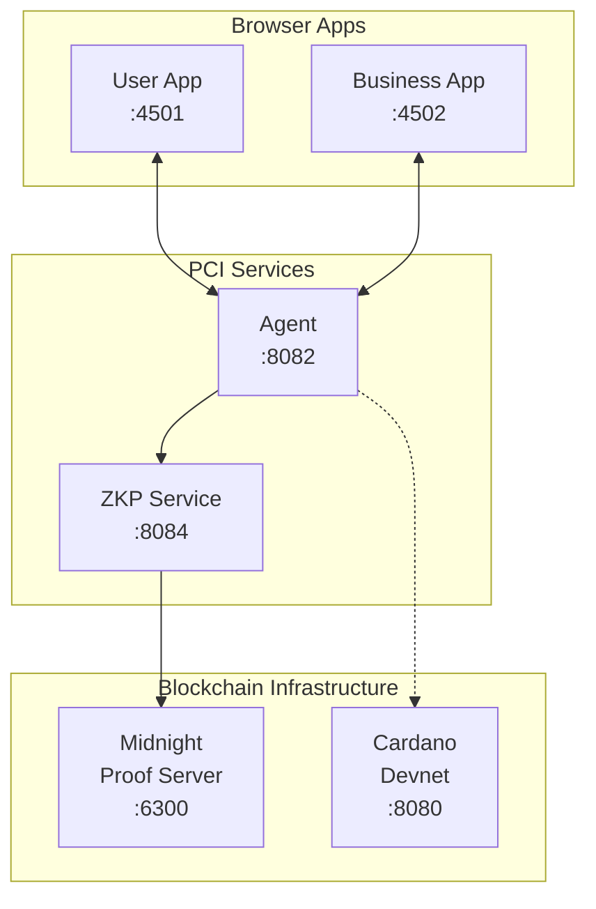
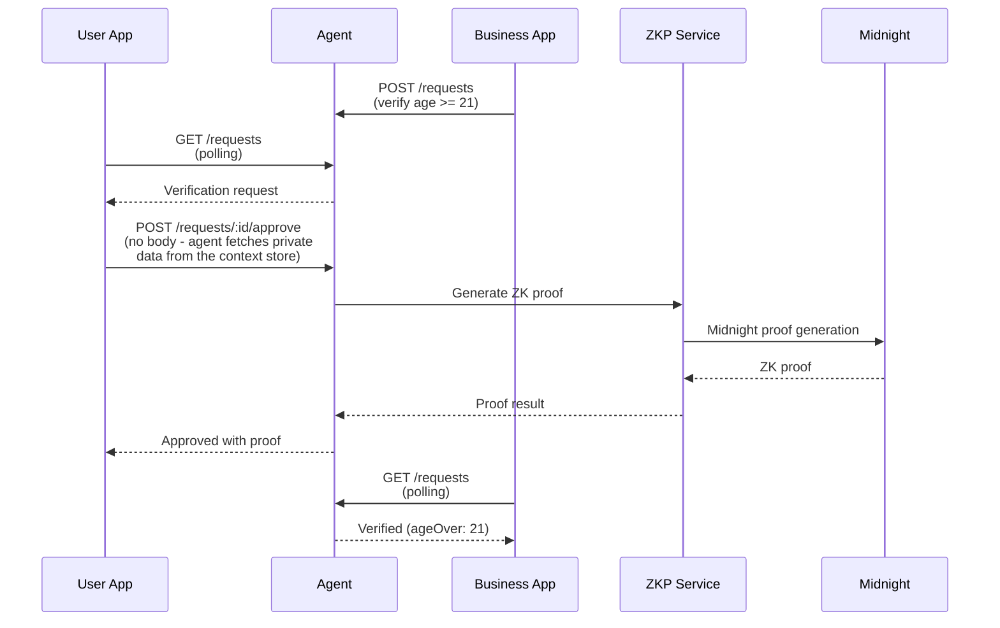

# PCI Demo

Interactive demonstration of Personal Context Infrastructure (PCI) showing privacy-preserving data sharing between users and businesses using zero-knowledge proofs.

## Overview

This demo showcases:

- **User App** - Request services, approve/deny verification requests, manage personal context
- **Business App** - Receive service requests, verify customer information without accessing raw data
- **Age Verification Flow** - Prove "user is >= 21" without revealing actual birth date

## Architecture



## Request Flow



The approval call carries **no request body**: the agent sources the user's
private data (e.g. birth date) from the encrypted context store itself, so
private data never travels in a plaintext HTTP body.

> **Note:** The service-catalogue / service-request flow (`/services`,
> `/service-requests`, `/service-requests/:id/complete`) was dropped in
> pci-agent's FastAPI migration and is being restored in
> [pci-agent#17](https://github.com/peteski22/pci-agent/issues/17). It is
> disabled in both apps until then; set the `VITE_ENABLE_SERVICE_FLOW=true`
> build arg (see `docker-compose.yml`) to re-enable it once the endpoints
> are back.

## Prerequisites

### For Docker Compose (full stack)

The docker-compose.yml builds backend services from sibling directories. Clone the required repos:

```bash
# Clone repos for Docker builds
mkdir pci && cd pci
gh repo clone peteski22/pci-demo
gh repo clone peteski22/pci-agent      # Required for docker compose
gh repo clone peteski22/pci-zkp        # Required for docker compose
gh repo clone peteski22/pci-context-store  # Required for docker compose

# Optional repos for reference/development:
gh repo clone peteski22/pci-contracts  # Aiken smart contracts
gh repo clone peteski22/pci-identity   # DID management library
gh repo clone peteski22/pci-docs       # Documentation
gh repo clone peteski22/pci-spec       # Specifications
```

### For Frontend Only (quick start)

If you only want to run the frontend apps against remote/existing services:

```bash
git clone https://github.com/peteski22/pci-demo.git
cd pci-demo
pnpm install
pnpm dev
```

The apps use published npm packages (`@peteski22/pci-identity`, etc.) - no sibling repos required.

## Quick Start

### Development Mode (recommended)

```bash
# Start backend services first (in separate terminals):

# Terminal 1: Cardano devnet (if not running)
# See yaci-devkit setup

# Terminal 2: ZKP service
cd ../pci-zkp && npx tsx sdk/src/server.ts

# Terminal 3: Agent
cd ../pci-agent && uv run python -m pci_agent

# Terminal 4: Frontend apps
cd pci-demo && pnpm dev
```

Access the apps:
- **User App:** http://localhost:4501
- **Business App:** http://localhost:4502

### Docker Compose

```bash
docker compose up --build

# User App:     http://localhost:4501
# Business App: http://localhost:4502
# Cardano Viewer: http://localhost:5173
```

### Deploy S-PAL Contracts (Optional)

Once the devnet is running, you can deploy S-PAL contracts:

```bash
# In a separate terminal, after docker compose is up:
cd ../pci-contracts
pnpm install
pnpm deploy:devnet

# Run integration tests against devnet:
pnpm test:integration
```

This deploys the S-PAL validator to the local Yaci Cardano devnet. Currently the demo works without deployed contracts (verification is off-chain), but contract deployment enables future on-chain policy enforcement.

## Demo Walkthrough

### 1. Request Verification (Business App)
1. Open http://localhost:4502
2. Click "Purchase Alcohol (21+)" under "Request Verification"
3. Watch the request appear under "Awaiting Customer"

### 2. Approve Verification (User App)
1. Open http://localhost:4501 and unlock the vault
2. See the "Verification Required" section under "My Requests"
3. Review what's being requested (age >= 21)
4. Click "Approve (Generate ZK Proof)" - no private data leaves the
   context store via the browser; the agent fetches it server-side

### 3. Proof Generated
1. Business App's "History" tab shows the resolved verification
2. Business sees the verification result - NOT the birth date

> With `VITE_ENABLE_SERVICE_FLOW=true` (after pci-agent#17), the walkthrough
> instead starts from the User App's "Services" tab and the business
> auto-responds and completes the transaction.

## Service Status

The User App's status bar shows the encrypted context-store connection. The
Agent, Midnight ZKP, and Cardano indicators come from the agent's `/services`
endpoint, so both apps show them only when `VITE_ENABLE_SERVICE_FLOW` is
enabled (pending pci-agent#17); until then the Business App shows no status
bar.

## Project Structure

```
pci-demo/
├── apps/
│   ├── user-app/        # User-facing React app
│   └── business-app/    # Business-facing React app
├── packages/
│   └── shared/          # Shared types (demo-specific)
├── docker-compose.yml   # Full stack orchestration
└── pnpm-workspace.yaml  # Monorepo config
```

## Local Development with PCI Packages

If you want to develop PCI packages locally while running the demo:

### Option 1: pnpm overrides (recommended)

Add overrides to the root `package.json`:

```json
{
  "pnpm": {
    "overrides": {
      "@peteski22/pci-identity": "link:../pci-identity"
    }
  }
}
```

Then run `pnpm install` to link the local package.

### Option 2: pnpm link

```bash
# In the pci-identity repo
cd ../pci-identity
pnpm build
pnpm link --global

# In pci-demo
cd ../pci-demo
pnpm link --global @peteski22/pci-identity
```

## Data Retention Enforcement

In this demo, the business app shows a disclaimer about "no retention" policies. In production, PCI enforces these policies through multiple mechanisms:

| Mechanism | Description | Status |
|-----------|-------------|--------|
| **Cryptographic Time-Locks** | Data encrypted with keys that automatically expire | Planned |
| **On-Chain Audit Trails** | All access events recorded on Cardano | Planned |
| **Threshold Decryption** | M-of-N community witnesses required for decryption | Planned |
| **Economic Incentives** | Businesses stake ADA collateral that can be slashed | Planned |
| **Graduated Trust** | New businesses have stricter requirements | Planned |

### How it works in production:

1. **Before sharing**: User checks business has sufficient stake on-chain
2. **During sharing**: Data is encrypted with time-locked keys, access recorded on Cardano
3. **After expiry**: Witnesses refuse to provide decryption shares
4. **Violation detected**: User submits claim to DAO, stake is slashed

See [PCI Technical Appendix - Data Retention Enforcement](https://github.com/peteski22/pci-docs/blob/main/architecture/technical-appendix.md#data-retention-enforcement) for full details.

## Related Repos

- [pci-agent](https://github.com/peteski22/pci-agent) - Coordination service (Python)
- [pci-zkp](https://github.com/peteski22/pci-zkp) - ZKP service with Midnight integration
- [pci-contracts](https://github.com/peteski22/pci-contracts) - Aiken smart contracts for Cardano
- [pci-context-store](https://github.com/peteski22/pci-context-store) - Encrypted local data storage
- [pci-docs](https://github.com/peteski22/pci-docs) - Documentation and specifications
- [pci-identity](https://github.com/peteski22/pci-identity) - DID management library

## License

Apache 2.0
